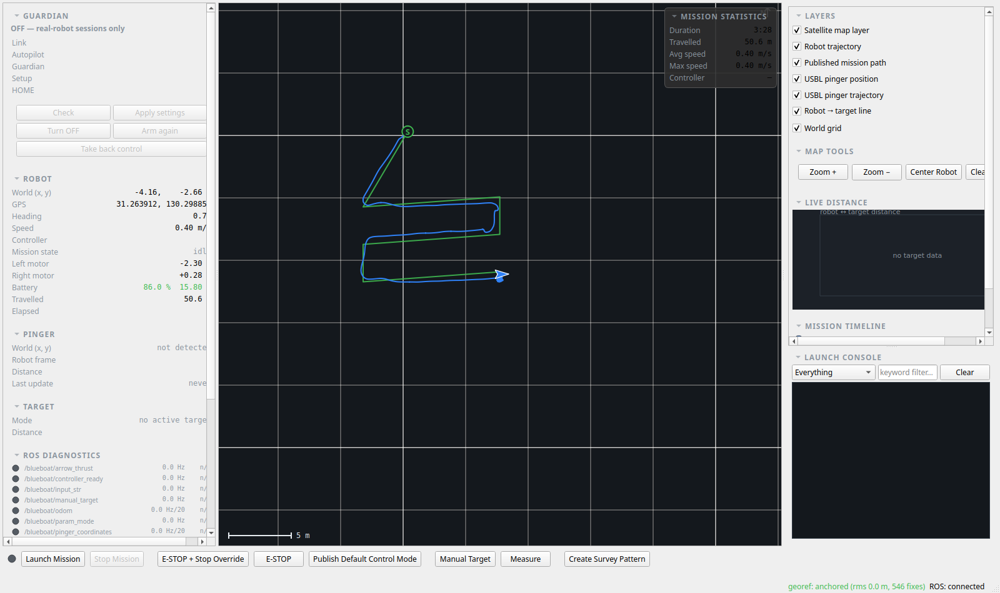
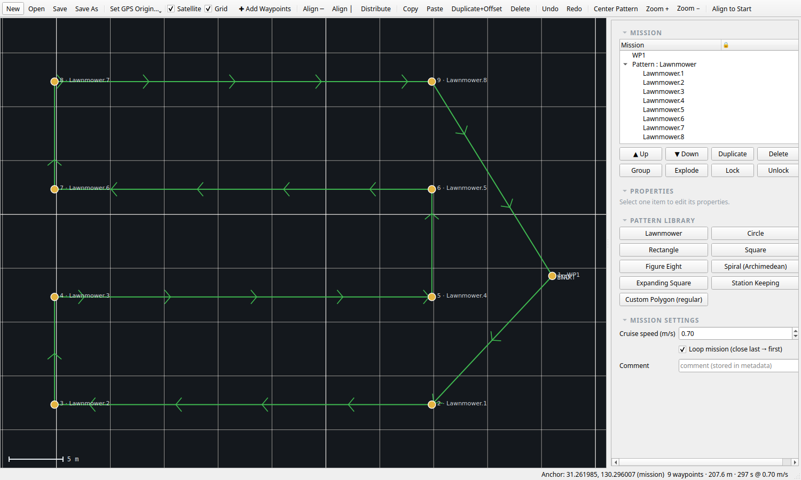

# BlueBoat Mission Control Station (MCS)

The operator's desktop app for the BlueRobotics
[BlueBoat](https://bluerobotics.com/store/boat/blueboat/) surveying with side-scan sonar. It
launches, watches and stops missions on the real boat or in the Gazebo simulator. It shows the
boat and its path on a north-up map with live data, and it holds the **Survey Pattern
Designer**, where you draw survey paths.



*The main window with a real pool run fed in. Green: the planned path, starting at **S**. Blue:
where the boat went, with the arrow at its current position and heading. Left: robot, pinger and
target values and the per-topic diagnostics. Right: map layers, plots and the launch console.
Bottom: launch, stop and emergency-stop buttons.*

The station does **no control computation**. Every number it shows comes from a ROS 2 topic of
the control stack (BlueBoat-Control). If a value looks wrong, check the node that publishes it
first.

## What you can do with it

- **Launch a mission** three ways: on the *real robot*, in a *Gazebo simulation* (empty world, or
  a generated harbour world with a simulated sonar), or *from a recorded ros2 bag* (a real run
  replayed in Gazebo).
- **Run sessions on the real boat**: connect once, then start and stop as many logged runs as you
  like with **START RUN** / **STOP RUN**, and change path or controller between runs.
- **Watch the boat** on a satellite map: true heading, trail, mission path, the acoustic pinger
  and the controller's target. Pan, zoom, click to read a GPS position.
- **Take over by hand**: click a point and the boat goes there (**Manual Target**), or drive it
  with the arrow keys.
- **Stop safely**: two emergency-stop buttons, and a stop sequence that hands the motors back to
  their normal mapping before closing anything.
- **Set up simulations**: sea state (current, waves, timed plans), sonar model and simulation
  slow-down.
- **Draw survey paths** in the Survey Pattern Designer: lawnmower, circle, spiral, expanding
  square, polygon..., anchored to GPS, saved as trajectory files the boat follows.



*The Survey Pattern Designer with a lawnmower pattern. The yellow dots are waypoints and the
arrows show the direction of travel. The pattern library is on the right; the status bar gives
the GPS anchor, the length and the duration at the cruise speed.*

## How it connects to the other modules

```
                     ┌──── ros2 launch ────▶ BlueBoat-Control (or BlueBoat-SSS-Sim worlds)
[ MCS (this app) ] ──┤
                     └◀─── ROS 2 topics ──── boat (via MAVROS and the BlueBoat WiFi)
```

| Module | Link | Relation to the station |
|---|---|---|
| BlueBoat-Control | [github.com/Kyyrron/BlueBoat-Control](https://github.com/Kyyrron/BlueBoat-Control) | The control stack the station launches and reads; required |
| BlueBoat-SSS-Sim | [github.com/Kyyrron/BlueBoat-SSS-Sim](https://github.com/Kyyrron/BlueBoat-SSS-Sim) | Generated Gazebo worlds, simulated sonar and sea state; optional |
| BlueBoat-Perception | [github.com/Kyyrron/BlueBoat-Perception](https://github.com/Kyyrron/BlueBoat-Perception) | The detector node, started by the station with real and world launches |
| BlueBoat-SSS | [github.com/Kyyrron/BlueBoat-SSS](https://github.com/Kyyrron/BlueBoat-SSS) | The sonar Ground Control Station, run beside this app |
| Whole project | [github.com/Kyyrron/BlueBoat-SideScanSonar](https://github.com/Kyyrron/BlueBoat-SideScanSonar) | The superproject; holds the link guardian the station controls |

Everything runs on the operator laptop. The boat carries only its own hardware and firmware
(ArduPilot / BlueOS).

## Dependencies

| Dependency | Link | Quick install |
|---|---|---|
| Ubuntu 24.04, Python 3.10 or newer | [ubuntu.com](https://ubuntu.com/download/desktop) | |
| ROS 2 Jazzy | [docs.ros.org](https://docs.ros.org/en/jazzy/Installation.html) | `sudo apt install ros-jazzy-desktop` |
| MAVROS | [mavros install](https://github.com/mavlink/mavros/blob/ros2/docs/installation.md#binary-package-deb) | `sudo apt install ros-jazzy-mavros` |
| BlueBoat-Control, built in `~/ros2_ws` | [README](https://github.com/Kyyrron/BlueBoat-Control) | see its installation |
| PySide6, numpy, scipy, PyYAML | `requirements.txt` | `pip install -r requirements.txt` |
| BlueBoat-SSS-Sim (optional) | [README](https://github.com/Kyyrron/BlueBoat-SSS-Sim) | for simulations in generated worlds |
| Internet (optional) | | for satellite tiles; the map works without them |

Missing pieces disable features instead of crashing: without ROS the app starts as a GUI only.

## Installation, step by step

The station is plain Python, not a colcon package. It ships inside the superproject.

```bash
# 1. Get the project with its submodules
mkdir -p ~/ros2_ws/src && cd ~/ros2_ws/src
git clone --recurse-submodules https://github.com/Kyyrron/BlueBoat-SideScanSonar.git

# 2. Install and build BlueBoat-Control first (its README), then build the workspace
cd ~/ros2_ws && source /opt/ros/jazzy/setup.bash && colcon build

# 3. Source the workspace and the venv (every new terminal)
cd ~/ros2_ws && source env.sh

# 4. Python dependencies of the station, once
cd ~/ros2_ws/src/BlueBoat-SideScanSonar/BlueBoat-MCS
pip install -r requirements.txt
```

`~/ros2_ws/env.sh` is a small file you create once in `~/ros2_ws`:

```bash
source .venv/bin/activate
source install/setup.bash
```

Notes:
- `rclpy` (ROS for Python) always comes from ROS, never from pip.
- Inside the workspace venv, do not pass `--user` to pip. A venv you make yourself needs
  `python3 -m venv --system-site-packages` so it sees the ROS packages.

## Check the installation

```bash
cd ~/ros2_ws && source env.sh
cd src/BlueBoat-SideScanSonar/BlueBoat-MCS
QT_QPA_PLATFORM=offscreen python3 smoke_test.py    # must end with SMOKE TEST PASSED
python3 run.py                                     # the window opens
```

The status bar should read **ROS: connected**. `bash build.sh` does it all in one go:
`colcon build`, `source env.sh`, then `python3 run.py`.

## Tips: when to use it, what to know

- **Use the station for every mission**, real or simulated. It takes care of the safe start and
  stop that the command line leaves to you.
- **Never kill a real-robot launch from the terminal.** **Stop Mission** (called **Turn Off
  Connection** in a real session) first sends `default` and waits until the boat confirms it left
  "override". Killing the launch can leave the motors in override.
- **E-STOP stops the motors, nothing else.** It stays latched until **Release E-STOP**; it does
  not end the mission or hand the boat back to the radio controller.
- **On real water the map stays empty for about a second**, until the first GPS fixes anchor it.
  No driving is needed.
- **The link guardian is ON by default** in every real session: if the laptop goes silent for
  15 s, the autopilot brings the boat back along its trail.
- **For simulated results, choose the sonar model "Ray-cast — harbour, fast"**. "Geometric" is
  the dialog default but is an older sonar. The allowed simulation settings are in the
  superproject's `SIM_VALIDITY_CONDITIONS.md`.
- **Rebuild after pulling BlueBoat-Control** (`colcon build`): an old build breaks things
  silently.
- Control-stack changes belong in BlueBoat-Control, never in this repository.

## Files and settings

| Path | Content |
|---|---|
| `~/.config/blueboat_mcs/config.json` | Optional settings override. Every topic name, threshold and folder is in `mcs/config/settings.py`; put only the keys you change |
| `~/.config/blueboat_mcs/trajectories/` | Designer paths: `<name>.yaml` (what the boat follows) and `<name>.meta.yaml` (editor data) |
| `~/.config/blueboat_mcs/sea_states/` | Saved sea-state plans |
| `~/worlds/<path>/<world>/` | Generated Gazebo worlds (from the BlueBoat-SSS-Sim World Builder) |
| `~/ros2_ws/data/Robot_data/` | Real-robot run logs and their ros2 bags |

## More documentation

| Document | What you find there |
|---|---|
| [docs/04_user_guide.md](docs/04_user_guide.md) | Every screen, button and dialog, the run session and the designer |
| [docs/DEVELOPMENT.md](docs/DEVELOPMENT.md) | How to work on this app: Claude Code, setup, tests, rules, next steps |
| [docs/05_trajectory_format.md](docs/05_trajectory_format.md) | The trajectory file format and GPS deployment |
| [docs/03_ros_integration.md](docs/03_ros_integration.md) | Every topic, service and launch command; the shutdown sequence |
| [docs/GPS_MAP_ARCHITECTURE.md](docs/GPS_MAP_ARCHITECTURE.md) | How the map places things from GPS |

Part of the [BlueBoat-SideScanSonar](https://github.com/Kyyrron/BlueBoat-SideScanSonar) project.

---

**Author** — BERTRAND Killian, Kyushu Institute of Technology, 2026.
